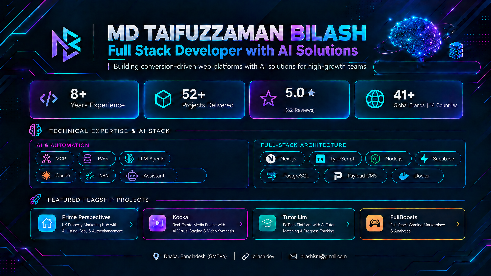

# Hi there, I'm Md Taifuzzaman Bilash 👋

### **Senior Full-Stack Web Developer with AI Solutions**
*Building conversion-driven web platforms, AI-native workflows, and automated systems for high-growth founders and product teams.*

---

[](https://bilash.dev)
[](mailto:bilashism@gmail.com)
[](https://wa.me/8801706053414)
[](https://bilash.dev)

---

### ⚡ Key Highlights & Impact
```text
┌───────────────────────────┬───────────────────────────┬───────────────────────────┐
│ 🚀 52+ Projects Delivered │ ⭐ 5.0/5 Avg Client Rating │ 🧠 AI Integration Expert  │
│ 💻 8+ Years Engineering   │ 🌍 41+ Global Brands      │ ⚡ AI-Assisted Speed     │
└───────────────────────────┴───────────────────────────┴───────────────────────────┘
```

---

## 🤖 AI Engineering, Automation & Assisted Development

I bridge the gap between cutting-edge AI capabilities and production-ready web applications. Whether building AI-native features for end-users or leveraging AI-assisted workflows to ship code 3x faster, I focus on measurable business outcomes and resilient system architecture.

### 🧠 Core AI & Automation Expertise
* **AI Feature Engineering:** Implementing Retrieval-Augmented Generation (**RAG**), Model Context Protocol (**MCP**), custom **LLM** integrations (OpenAI GPT-4o, Claude API), AI Agents, and specialized AI Chatbots.
* **Computer Vision & Media Pipelines:** Automated HDR image merging, AI photo decluttering, automated virtual staging, and AI video generation pipelines (Autoenhance AI, ChatGPT image editing).
* **AI-Assisted Development Workflow:** Utilizing **Cursor**, **Lovable**, **GitHub Copilot**, and tailored prompt engineering to rapidly prototype, write type-safe code, and optimize production applications.
* **Workflow & Ops Automation:** Designing autonomous automation workflows with **N8N**, **OpenClaw**, background job queues (**BullMQ**), webhooks, and custom Google Apps Script automation.

---

## 🚀 Featured AI & Full-Stack Projects

### 🏢 [Prime Perspectives](https://bookings.primeperspectives.com) — *UK Property Marketing & AI Platform*
* **Stack:** Next.js / TanStack Start, Supabase, TypeScript, Tailwind CSS, Autoenhance AI, OpenAI (GPT-4o), Stripe
* **AI Features:** Integrates GPT-4o to automatically analyze shoot photos and metadata to generate ready-to-publish estate agent listing descriptions. Features AI photo decluttering and Autoenhance AI HDR photo processing.
* **Impact:** Streamlined property marketing operations for UK estate agents, replacing fragmented manual workflows with an automated, single-dashboard experience.

### 📸 [Kocka](https://kocka.homes) — *Real-Estate Media & AI Production Suite*
* **Stack:** React, TanStack Query, React Hook Form, JWT, Node.js, AI Processing Services
* **AI Features:** One-click AI photo polish (day-to-dusk conversion, room decluttering), digital virtual staging for empty properties, and automated AI listing video generation.
* **Impact:** Fully automated real-estate shoot bookings, media delivery, and AI asset creation, with per-run usage logging for studio cost control.

### 🎓 [Tutor Lim (Next.js)](https://tutorlim.com.au) — *AI-Powered EdTech & Tutoring Platform*
* **Stack:** Next.js, TypeScript, React Router, TanStack Query, JWT Authentication
* **AI Features:** AI-driven tutor matching algorithm based on student learning needs, automated knowledge-gap detection, and smart academic progress tracking.
* **Impact:** Connects students across Australia with top-tier STEM and humanities tutors through personalized, data-driven learning paths.

### 🎮 [FullBoosts](https://fullboosts.com) — *Global Gaming Marketplace*
* **Stack:** TypeScript, React, Node.js, Express.js, MongoDB, Mongoose, Stripe, Payoneer
* **Features:** Custom full-stack e-commerce marketplace connecting global gamers with buyers and suppliers, complete with real-time analytics dashboards.

---

## 🛠️ Technical Stack & Tooling

```markdown
┌──────────────────────┬────────────────────────────────────────────────────────────────────────┐
│ Category             │ Technologies & Frameworks                                              │
├──────────────────────┼────────────────────────────────────────────────────────────────────────┤
│ 🤖 AI & Automation   │ MCP, RAG, LLM, OpenAI, Claude, Cursor, Lovable, Copilot,              │
│                      │ N8N, OpenClaw, Autoenhance AI, AI Agents & Chatbots                    │
├──────────────────────┼────────────────────────────────────────────────────────────────────────┤
│ 💻 Frontend          │ Next.js 15 (App Router, RSC), React 19, TypeScript, Tailwind CSS v4,   │
│                      │ Framer Motion, Shadcn UI, TanStack Query/Start, Redux, Zustand, WebGL  │
├──────────────────────┼────────────────────────────────────────────────────────────────────────┤
│ ⚙️ Backend & API     │ Node.js 22, Express.js, Nest.js, Hono, Fastify, REST APIs, GraphQL,    │
│                      │ Better Auth, Clerk, JWT, Webhooks, WebSockets                          │
├──────────────────────┼────────────────────────────────────────────────────────────────────────┤
│ 🗄️ Database & Cloud  │ PostgreSQL, Supabase, Prisma, Drizzle, MongoDB, Mongoose, Firebase,    │
│                      │ Docker, VPS (SQS/EventBridge), Vercel, Cloudflare, CI/CD, Nginx        │
├──────────────────────┼────────────────────────────────────────────────────────────────────────┤
│ 📦 CMS & Commerce    │ Payload CMS, Headless WordPress (WPGraphQL), Shopify 2.0 (Liquid/      │
│                      │ Hydrogen), HubSpot CMS, Squarespace Developer Platform                 │
└──────────────────────┴────────────────────────────────────────────────────────────────────────┘
```

---

## 💼 Work Experience Timeline

* **Senior Full Stack Web Developer** @ *Prime Perspectives (UK)* | **May 2025 – Present**
  * Leading full-stack engineering with Next.js, TypeScript, PostgreSQL, and Supabase; building AI property marketing automation tools.
* **Full Stack Developer** @ *Dashboard Lim (Australia)* | **May 2024 – May 2025**
  * Engineered data dashboards and full-stack web architectures with TypeScript.
* **Full Stack Developer** @ *FullBoosts (Israel)* | **Jun 2023 – Oct 2024**
  * Led frontend and backend engineering for a high-traffic gaming marketplace platform.
* **Frontend Developer** @ *HearthPwn (Czech Republic)* | **Feb 2022 – Dec 2022**
  * Built internal operations automation tools allowing instant batch processing of 500+ articles.
* **Senior Freelance Web Developer & Consultant** @ *Upwork & Fiverr* | **2018 – Present**
  * Completed 50+ projects for 41+ clients across 14 countries with a **5.0/5.0 rating** across 60+ verified client reviews.

---

## 💬 What Leaders & Founders Say

> *"Bilash was a pleasure to work with. He is highly professional, responsive, and skilled at solving problems efficiently... I would highly recommend him to anyone looking for a reliable and knowledgeable developer."*  
> — **Mira S.**, Switzerland ⭐⭐⭐⭐⭐

> *"Working with T. Bilash was an absolute pleasure! He went above and beyond, not only delivering exactly what we needed but also providing insightful recommendations that we hadn't even considered."*  
> — **Jeremy H.**, United States ⭐⭐⭐⭐⭐

> *"I am very impressed with the work done... He is extremely knowledgeable and has some great ideas for my site. He really listens to my needs and delivers exactly what I want."*  
> — **Kam S.**, United Kingdom ⭐⭐⭐⭐⭐

---

## 📬 Let's Connect & Collaborate

I partner with founders, CTOs, and product leaders to design, build, and ship performant, AI-enhanced web platforms.

* 🌐 **Portfolio Website:** [bilash.dev](https://bilash.dev)
* 📧 **Direct Email:** [bilashism@gmail.com](mailto:bilashism@gmail.com)
* 📱 **WhatsApp:** [+8801706053414](https://wa.me/8801706053414)
* 📅 **Book a Call:** [Schedule a Strategy Call](https://bilash.dev/#contact)
* 📍 **Location:** Dhaka, Bangladesh (Remote worldwide | Flexible timezone alignment for US, UK, AU)

---

